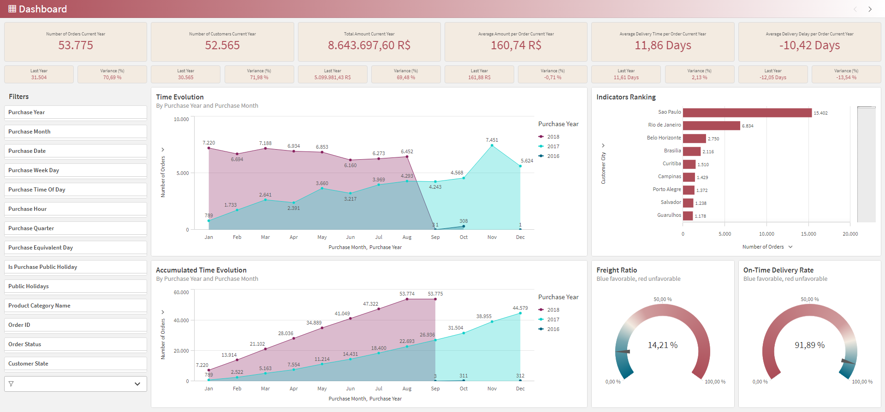
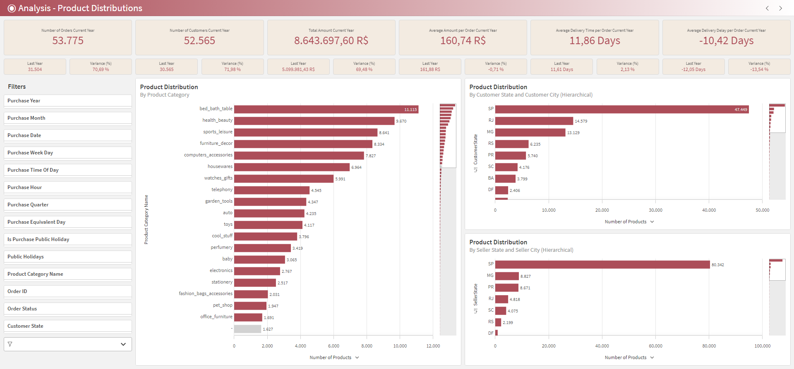
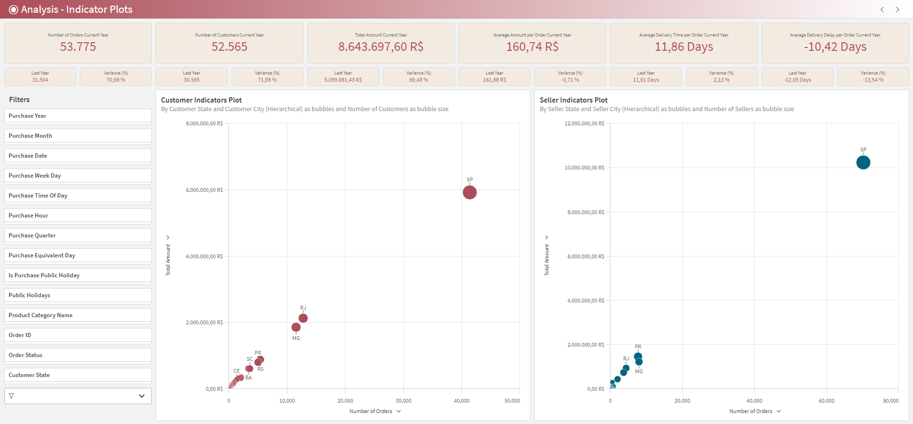
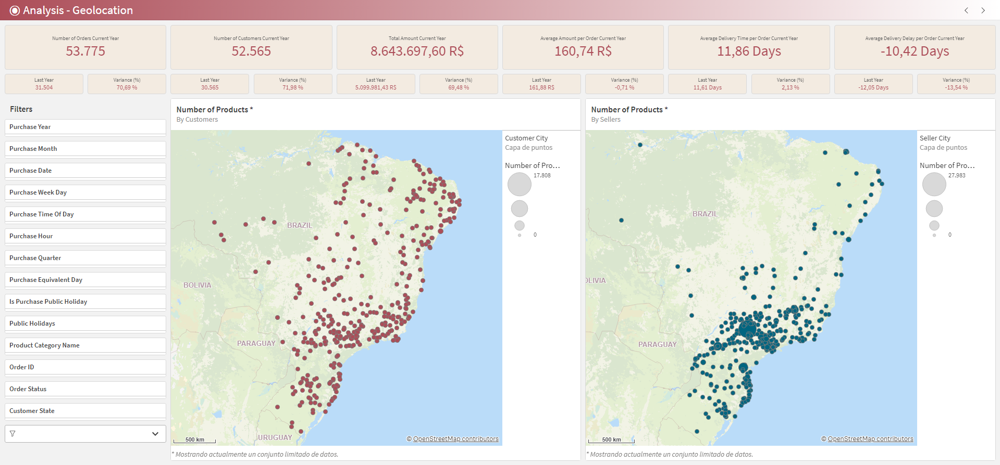
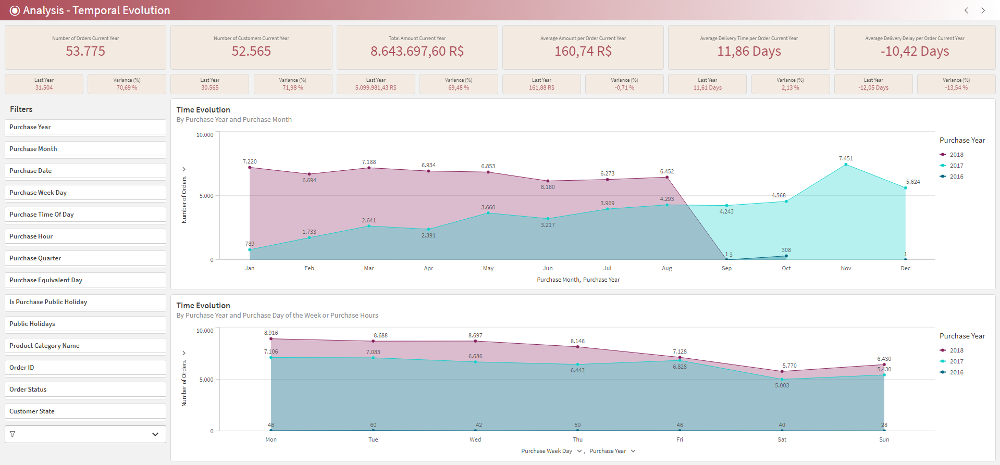
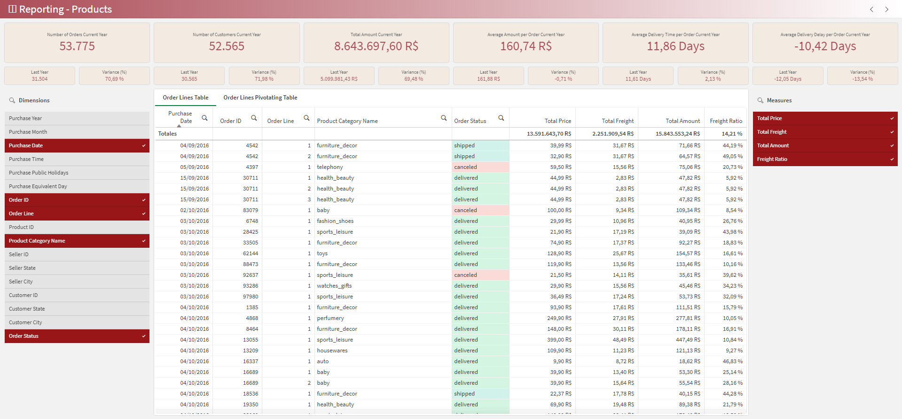
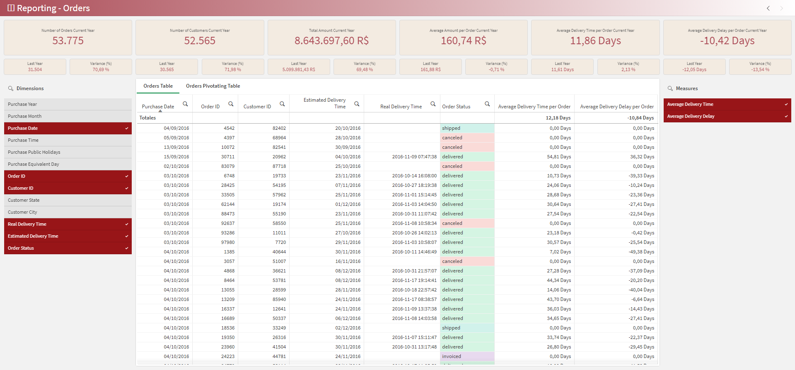

# Olist E-Commerce – Business Intelligence with Qlik Sense

**English** | [Español](README_ES.md)

End-to-end Business Intelligence project built with **Qlik Sense** on the [Brazilian E-Commerce Public Dataset by Olist](https://www.kaggle.com/datasets/olistbr/brazilian-ecommerce) (~100,000 orders, 2016–2018). It covers data extraction, transformation, a star-schema model and an interactive dashboard focused on **sales** and **delivery times**.

The project was developed during my curricular internship (*Master's Degree in Data Science*) at **Mercanza S.L.U.**



## Architecture

The project is split into three Qlik Sense apps. Each one reads the QVD files produced by the previous one:

| App | Input | Output | Purpose |
|---|---|---|---|
| `1_Extract` | `data/raw/` (9 CSV + public holidays XLS) | `data/extracted/*.qvd` | Loads the raw sources and stores them as QVD |
| `2_Transform` | `data/extracted/*.qvd` | `data/modified/*.qvd` | Cleaning, typing, joins and star-schema modelling |
| `3_Visualization` | `data/modified/*.qvd` | — | Measures, master items and dashboard sheets |

All paths go through a single folder data connection named **`Repo`** that points to the root of the repository (`lib://Repo/data/...`).

## Data model

The nine normalised source tables are remodelled into a **star schema**:

- A single **`Facts`** table that concatenates two fact types, told apart by `FactType`:
  - `OrderLine`: one row per order item (product, seller, price, freight).
  - `OrderTimes`: one row per order (purchase, delivery and estimated delivery dates).
- Dimensions: `Products`, `Sellers`, `Customers`, `Info`, a master calendar (`PurchaseCalendar`, including Brazilian public holidays) and a master timetable (`PurchaseTimetable`).

Measures are built **hierarchically** from a few base measures using Set Analysis, so a change to a base measure propagates to every KPI that depends on it.

## Sheets

Every sheet shares a header with six KPIs (orders, customers, total amount, average amount per order, average delivery time and average delivery delay), each compared with the previous year. The comparison is **year-to-date (YTD)** up to the last date available in the data. In other words, the current year is compared with the same period of the previous year.

| Sheet | Content |
|---|---|
| **Dashboard** | Monthly and cumulative evolution, indicator ranking, freight ratio and on-time delivery rate |
| **Analysis – Product Distributions** | Sales by category and by customer / seller location |
| **Analysis – Indicator Plots** | Orders vs. total amount by customer and seller location (state → city) |
| **Analysis – Geolocation** | Maps of customers and sellers |
| **Analysis – Temporal Evolution** | Orders by month, weekday and hour |
| **Reporting – Products** | Configurable detail tables for order lines |
| **Reporting – Orders** | Configurable detail tables for delivery times |

<details>
<summary><b>Full visualization app</b></summary>

**Dashboard**


**Analysis – Product Distributions**


**Analysis – Indicator Plots**


**Analysis – Geolocation**


**Analysis – Temporal Evolution**


**Reporting – Products**


**Reporting – Orders**


</details>

## Repository structure

```
.
├── apps/                  # Qlik Sense apps (.qvf)
│   ├── 1_Extract.qvf
│   ├── 2_Transform.qvf
│   └── 3_Visualization.qvf
├── scripts/               # Load scripts as plain text (.qvs)
├── images/                # Screenshots
├── data/                  # Not included, created locally (see below)
│   ├── raw/               # Source CSV + XLS
│   ├── extracted/         # Generated by 1_Extract
│   └── modified/          # Generated by 2_Transform
├── README.md
└── README_ES.md
```

## How to run it

1. Install **Qlik Sense Desktop** or use **Qlik Cloud Analytics**.
2. Clone or download this repository.
3. Create the `data/` folder inside the repository with three subfolders: `raw/`, `extracted/` and `modified/`.
4. Download the data into `data/raw/`:
   - The nine CSV files from [Kaggle](https://www.kaggle.com/datasets/olistbr/brazilian-ecommerce).
   - `feriados_nacionais.xls` from [ANBIMA](https://www.anbima.com.br/feriados/).
5. Import the three `.qvf` files from `apps/` and create a folder data connection named **`Repo`** that points to the root of the repository.
6. Reload the apps in order: **1_Extract → 2_Transform → 3_Visualization**.

> The source data is not included in this repository.

## Author

**Joan Merlos Cremades**
