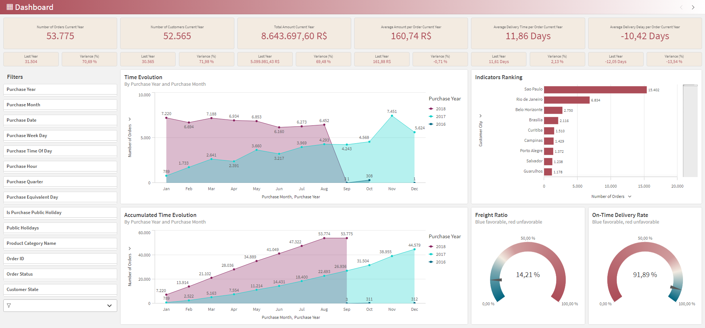
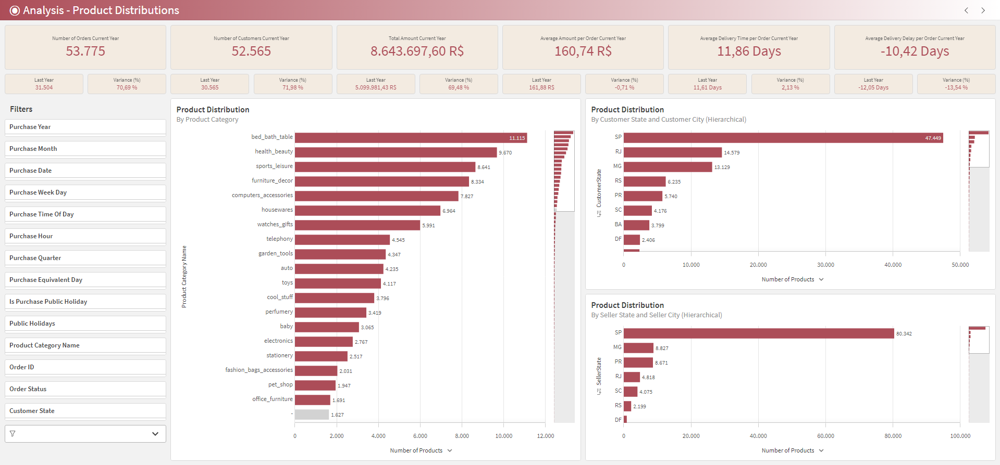
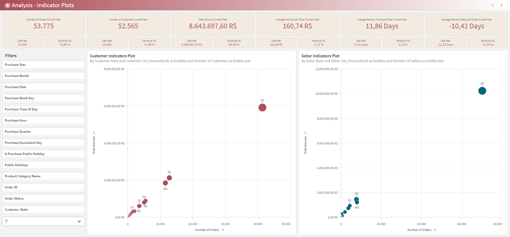
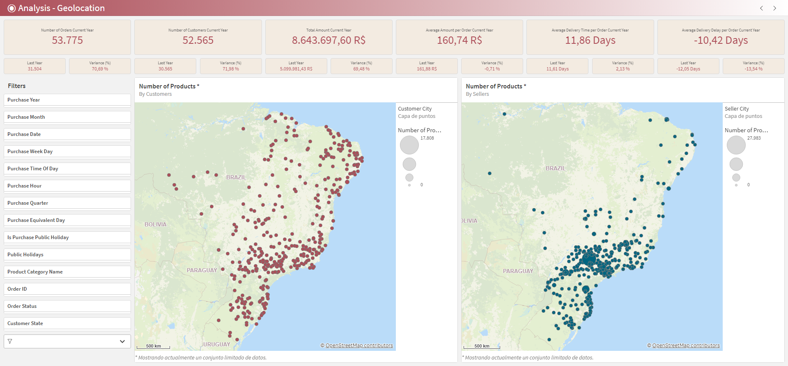
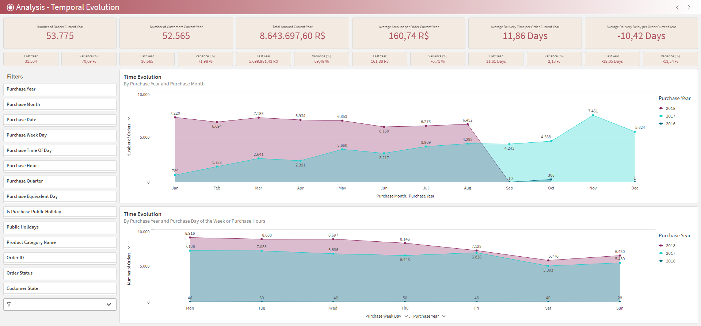
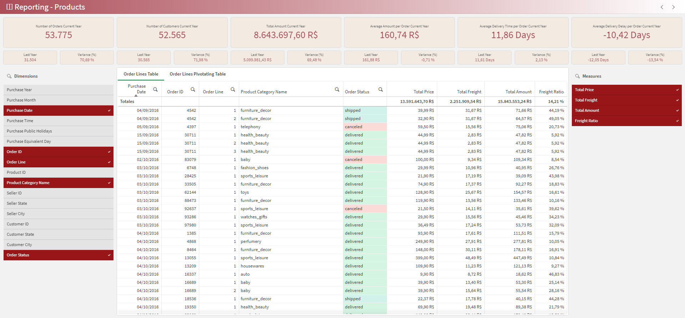
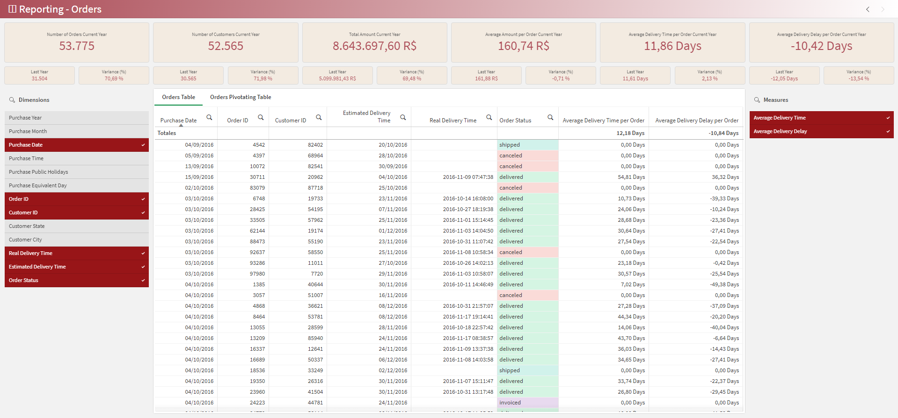

# Olist E-Commerce – Business Intelligence con Qlik Sense

[English](README.md) | **Español**

Proyecto completo de Business Intelligence desarrollado con **Qlik Sense** sobre el [Brazilian E-Commerce Public Dataset by Olist](https://www.kaggle.com/datasets/olistbr/brazilian-ecommerce) (unos 100 000 pedidos entre 2016 y 2018). Incluye la extracción y transformación de los datos, un modelo en estrella y un cuadro de mando interactivo centrado en las **ventas** y los **tiempos de entrega**.

El proyecto se desarrolló durante mis Prácticas Curriculares del *Máster Universitario en Ciencia de Datos* en **Mercanza S.L.U.**



## Arquitectura

El proyecto se divide en tres aplicaciones de Qlik Sense. Cada una lee los QVD generados por la anterior:

| Aplicación | Entrada | Salida | Función |
|---|---|---|---|
| `1_Extract` | `data/raw/` (9 CSV + XLS de festivos) | `data/extracted/*.qvd` | Carga las fuentes en crudo y las guarda en QVD |
| `2_Transform` | `data/extracted/*.qvd` | `data/modified/*.qvd` | Limpieza, formatos, cruces y modelado en estrella |
| `3_Visualization` | `data/modified/*.qvd` | — | Medidas, elementos maestros y hojas del cuadro de mando |

Todas las rutas usan una única conexión de datos de carpeta llamada **`Repo`**, que apunta a la raíz del repositorio (`lib://Repo/data/...`).

## Modelo de datos

Las nueve tablas normalizadas de origen se remodelan en un **esquema en estrella**:

- Una única tabla **`Facts`** que concatena dos tipos de hechos, que se distinguen por el campo `FactType`:
  - `OrderLine`: una fila por línea de pedido (producto, vendedor, precio y coste de envío).
  - `OrderTimes`: una fila por pedido (fechas de compra, de entrega y de entrega estimada).
- Dimensiones: `Products`, `Sellers`, `Customers`, `Info`, un calendario maestro (`PurchaseCalendar`, con los festivos de Brasil) y un horario maestro (`PurchaseTimetable`).

Las medidas se construyen de forma **jerárquica** a partir de unas pocas medidas base con Set Analysis, de modo que cualquier cambio en una medida base se propaga a todos los KPI que dependen de ella.

## Hojas

Todas las hojas comparten una cabecera con seis KPI: pedidos, clientes, importe total, importe medio por pedido, tiempo medio de entrega y retardo medio de entrega. Cada uno se compara con el año anterior. La comparación es de tipo **year-to-date (YTD)** hasta la última fecha disponible en los datos. En otras palabras, el año actual se compara con el mismo periodo del año anterior.

| Hoja | Contenido |
|---|---|
| **Dashboard** | Evolución mensual y acumulada, ranking de indicadores, freight ratio y tasa de entregas a tiempo |
| **Analysis – Product Distributions** | Ventas por categoría y por ubicación de clientes y vendedores |
| **Analysis – Indicator Plots** | Pedidos frente a importe total por ubicación de clientes y vendedores (estado → ciudad) |
| **Analysis – Geolocation** | Mapas de clientes y vendedores |
| **Analysis – Temporal Evolution** | Pedidos por mes, día de la semana y hora |
| **Reporting – Products** | Tablas de detalle configurables de las líneas de pedido |
| **Reporting – Orders** | Tablas de detalle configurables de los tiempos de entrega |

<details>
<summary><b>Aplicación de visualización completa</b></summary>

**Dashboard**


**Analysis – Product Distributions**


**Analysis – Indicator Plots**


**Analysis – Geolocation**


**Analysis – Temporal Evolution**


**Reporting – Products**


**Reporting – Orders**


</details>

## Estructura del repositorio

```
.
├── apps/                  # Aplicaciones de Qlik Sense (.qvf)
│   ├── 1_Extract.qvf
│   ├── 2_Transform.qvf
│   └── 3_Visualization.qvf
├── scripts/               # Scripts de carga en texto plano (.qvs)
├── images/                # Capturas
├── data/                  # No incluida, se crea en local (ver abajo)
│   ├── raw/               # CSV y XLS de origen
│   ├── extracted/         # Generada por 1_Extract
│   └── modified/          # Generada por 2_Transform
├── README.md
└── README_ES.md
```

## Cómo ejecutarlo

1. Instala **Qlik Sense Desktop** o usa **Qlik Cloud Analytics**.
2. Clona o descarga este repositorio.
3. Crea la carpeta `data/` dentro del repositorio con tres subcarpetas: `raw/`, `extracted/` y `modified/`.
4. Descarga los datos en `data/raw/`:
   - Los nueve CSV desde [Kaggle](https://www.kaggle.com/datasets/olistbr/brazilian-ecommerce).
   - `feriados_nacionais.xls` desde [ANBIMA](https://www.anbima.com.br/feriados/).
5. Importa los tres `.qvf` de `apps/` y crea una conexión de datos de carpeta llamada **`Repo`** que apunte a la raíz del repositorio.
6. Recarga las aplicaciones en orden: **1_Extract → 2_Transform → 3_Visualization**.

> Los datos de origen no se incluyen en el repositorio.

## Autor

**Joan Merlos Cremades**
